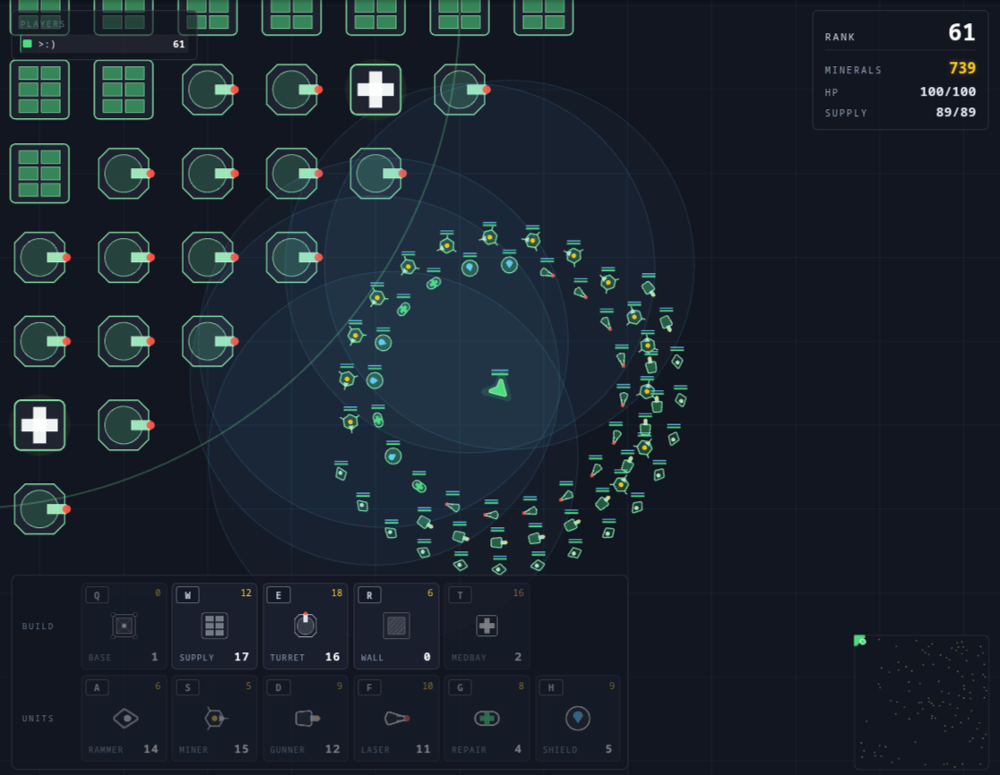

# openspace

Multiplayer top-down space arena: mine asteroids, build bases and turrets, command drones, fight other players.



Live: <https://space.lastra.us>

Server-authoritative physics via Rapier2D, geometric Pixi.js
rendering, Colyseus state sync, Svelte 5 HUD.

## Usage

| Key | Action |
| --- | --- |
| Mouse | Steer toward cursor |
| **Left-click** | Designate focus target: owned attack units pursue and fire on the picked enemy / miners pursue the picked asteroid. Click empty space to clear. |
| **Space** (hold) | Recall fleet + sustained dash (burns your own units while held) |
| **A / S / D / F / G / H** | Spawn rammer / miner / gunner / laser / repair / shielder |
| **Q / W / E / R / T** | Toggle base / supply / turret / wall / medbay placement (click to place) |
| **X** | Recycle mode: click an owned structure for partial credit refund |
| **Esc** or **Right-click tap** | Cancel placement / recycle mode |
| **Right-click hold + drag** | Open radial emote menu, drag to a wedge to send |
| **F1** | Debug overlay (hitboxes, target lines, prediction divergence) |

You start with a free base (Q) and a small credit pile. Drop the base to
unlock unit production: units spawn at your base and respawn there on
death. Mine asteroids with miners (per-tick drip while attached), spend
credits on units and structures, and your base projects a 600u
**territorial claim** that blocks enemies from building near you. Your
buildings are one-way: your own units, ship, and projectiles pass
through them; enemies are stopped. The world center has a no-build spawn
bubble and fresh ships get **20s of spawn invulnerability**. Lose your
ship and you drop a gold wreckage square holding your credits +
orphaned units. First player to touch it claims everything (expires
after 30s).

## Known landmines

- **Schema decorator emit**: TS class-field initializers shadow
  `defineTypes` getters. Use constructor-init pattern with
  `useDefineForClassFields: false`.
- **DPR drift**: camera math uses `app.canvas.getBoundingClientRect()`,
  not `renderer.width / resolution` (Firefox disagrees).
- **Server time is the simulation clock**: `state.serverTime` advances by
  exactly `TICK_MS` per tick (`setFixedTimestep`), and the room sends one
  patch per tick from `update()`. Don't stamp it with wall time: physics
  steps a fixed dt, so wall-clock stamps turn timer jitter into visible
  speed changes in client interpolation.
- **Rapier init is async**: cached at process scope, shared across
  rooms.
- **Body cleanup is mandatory**: `removeRigidBody` on every destroy,
  `world.free()` on room dispose. WASM heap leaks otherwise.
- **Owner-bit count is hard-capped** at `MAX_PLAYERS_PER_ROOM = 15`.
  The collision-group mask is derived from this; raising the cap past
  16 requires switching the bit packing strategy (Rapier groups are
  16+16 bits).
- **Local predictor and owned structures**: `worldObstacles` in
  `game.ts` takes the local sessionId so it can skip every structure
  the local player owns. Without that, prediction collides with
  buildings the server lets you pass through, producing constant
  reconciles.

## How it works

The server runs the whole simulation in Rapier and syncs it to clients
through Colyseus; each client only sees entities near its ship. The
client predicts its own ship with the shared `stepPlayer` and
interpolates everything else. Structures let their owner through by giving
each player a collision-group bit, which sidesteps pathfinding.
[docs/architecture.md](docs/architecture.md) has the package layout and
the authority, combat and event details.

## Development

```bash
pnpm install
pnpm dev
```

Open <http://localhost:5173> in two browser tabs, pick a name, fly with
the cursor.

| Command | Effect |
| --- | --- |
| `pnpm dev` | Server (2567) + client (5173) with hot reload |
| `pnpm typecheck` | Strict TS across all packages (incl. svelte-check) |
| `pnpm lint` | ESLint over the repo |
| `pnpm test` | Vitest for shared pure helpers |
| `pnpm build` | Production builds (shared, then server, then client) |

[docs/extending.md](docs/extending.md) covers adding a unit or structure kind.
